<!-- 

  

 -->

  

<h2 align="center">Zarif Hasan</h2>

  <b>Full-Stack Developer</b>
   
  <i>"Burdened with glorious code"</i>

  
  
  

<h2>🧩 Tech Multiverse</h2>

<table width="100%" align="center">
  <tr>
    <td width="50%" align="center" valign="top">
      <h3 align="center">🎨 Frontend &amp; UI</h3>
      

    </td>
    <td width="50%" align="center" valign="top">
      <h3 align="center">⚙️ Backend &amp; Database</h3>
      

    </td>
  </tr>
  <tr>
    <td width="50%" align="center" valign="top">
      <h3 align="center">🛠 Tools &amp; DevOps</h3>
      

    </td>
    <td width="50%" align="center" valign="top">
      <h3 align="center">🌐 Deployment</h3>
      

    </td>
  </tr>
</table>

<h2>📊 GitHub Ecosystem</h2>

  
  

  

  

